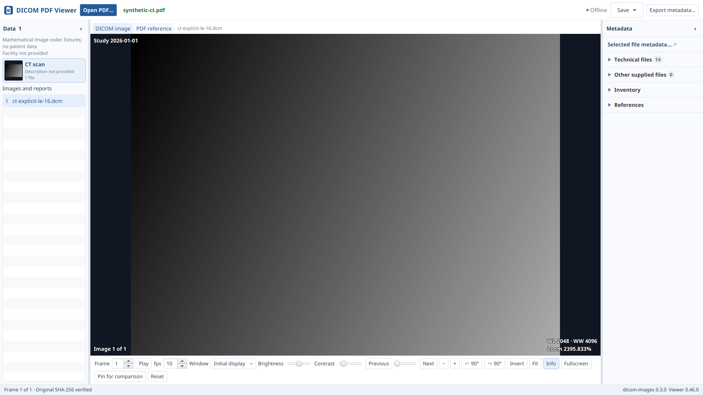
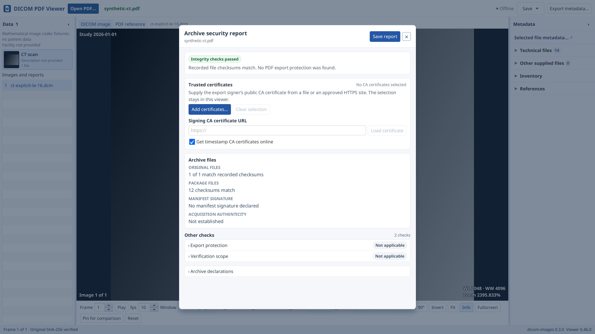

# Archival DICOM in PDF/A

Medical imaging is increasingly digital, yet patients often receive images that require specialized software, proprietary viewers, or access to systems that may not remain available.

This project creates portable, self-contained PDF/A-4f archives for long-term preservation and patient access. Original DICOM files and metadata remain unchanged, alongside readable reference images, organized study information, and instructions for recovering the original medical data. The PDF pages work in an ordinary reader; an optional offline viewer provides interactive access.

To view a converted DICOM archive, choose **Open PDF…** or drop the PDF onto the
viewer. Use the desktop creator or command-line converter for loose DICOM files,
folders, and ZIP archives.

Cryptographic hashes, C2PA Content Credentials, optional institutional digital signatures (including PAdES B-LTA), trusted timestamps, and independent validation provide evidence of integrity and authenticated export provenance. Signed, timestamped evidence-renewal files can extend that evidence without changing the original archive. The long-term goal is to keep records verifiable as technology and cryptographic standards evolve.

The goal is a standards-based, vendor-neutral solution for medical imaging manufacturers and healthcare organizations, allowing patients to retain, verify, view, and share their original records for decades without depending on proprietary software, obsolete viewers, or continued access to the originating institution.

**Archive features:**

- **Unchanged originals:** Preserve every supplied file, including unsupported or damaged objects, with recovery independent of the viewer.
- **Readable context:** Labeled reference images link to their original sources and frames; metadata is indexed without inventing missing information.
- **Verifiable inventory:** A manifest records what was preserved and how the archive's reference images relate to the originals.
- **Independent checks:** Verify recovered bytes, metadata mappings, PDF/A conformance, and available signature, timestamp, and trust evidence separately.
- **[C2PA Content Credentials](docs/SECURITY.md#c2pa-content-credentials):** Signed export provenance and tamper evidence accompany the archive, with signer trust assessed separately.
- **[PAdES B-LTA signatures](docs/SECURITY.md#eu-dss-pades-b-lta):** Optional institutional PDF signing retains validation evidence and trusted archival timestamps, with renewal for long-term verification.

**Preservation scope:**

Archives preserve the supplied records, with verification of integrity and available export provenance. See the [security documentation](docs/SECURITY.md) for supported protection and the [user guide](docs/GUIDE.md) for privacy and handling guidance.

**Documentation:**

- [Desktop creator and validator](docs/GUIDE.md#desktop-creator-and-validator)
- [Standalone Java DICOM viewer](docs/GUIDE.md#desktop-dicom-viewer)
- [User guide, conversion and recovery](docs/GUIDE.md)
- [Supported formats](docs/GUIDE.md#image-support) and [known limitations](UNSUPPORTED_FORMATS)
- [Run the tests](docs/VERIFICATION.md)
- [Archival profile specification](docs/profile/0.3.0/PROFILE.md)
- [Content Credentials profile](docs/profile/0.4.0/PROFILE.md)
- [Independent verification](docs/INDEPENDENT-VALIDATION.md)
- [Signing, timestamps, renewal and trust](docs/SECURITY.md)
- [Signing configuration and certificate setup](docs/SIGNING_CONFIGURATION.md)
- [Reusable PDF security library](docs/PDF_SECURITY_LIBRARY.md)
- [DICOM specification review](docs/SPEC-REVIEW.md) and [source validation scope](docs/DICOM-STRUCTURE.md)
- [Third-party notices](THIRD_PARTY_NOTICES.md)

During desktop creation, **Activity** reports file counts, reference-page
generation, signing, timestamping and validation. The app also displays elapsed
time and periodic updates while a step has no new output.

To view an existing archive, run `java -jar dist/dicom-pdf-0.46.0-viewer.jar` or open
[the standalone viewer](src/main/resources/viewer.html) in your browser and choose
**Open PDF…**. The standalone browser viewer and Chrome
extension are built together and show their shared version in the status bar.
The viewer can display the first image while
archive checks run in the background. The current application distribution
(`0.46.0`) embeds viewer `0.70.0` in new archives.



The updated viewer also opens DICOM Surface Segmentation attachments in a
rotatable **3D surface** tab, including older exports such as `LASegSample.dcm`.
Open the existing PDF with the updated viewer. See the [supported formats](docs/GUIDE.md#image-support).

Click the PDF filename to open the archive security report. It checks supported
PDF signatures, RFC 3161 timestamps, C2PA credentials and DICOM PAdES B-LTA
revisions on this device. Both viewers can use approved public timestamp CAs and the bundled DigiCert
timestamp CA. Select the signer’s CA certificate from a
file or an approved HTTPS site. The extension shows signature-by-signature hashing progress, and the desktop
shows the verification stage. Changing the CA selection for an open
archive rechecks certificate trust using the completed integrity checks.
See [browser security verification](docs/SECURITY.md#viewer-results).



*Archive security report in desktop viewer `0.46.0`.*

Every branch push to GitHub triggers a release build that advances both minor
versions and resets their patch versions to zero. Before committing the version
bump, the workflow runs the viewer and Chrome extension CI checks on the updated
versions and tests the three runnable JARs with veraPDF. It publishes the JARs,
standalone viewer, extension ZIP, and SHA-256 checksums as a workflow artifact. The
[source build instructions](docs/GUIDE.md#building-from-source) cover local
rebuilds and the automated version commit.

## Regenerate DICOM PDFs

Keep supplied inputs in `in/` and converted PDFs in `out/`. Git ignores both
directories. Use `examples/` for representative files suitable for sharing.

[scripts/dicom-regenerate.sh](scripts/dicom-regenerate.sh) converts files from
`in/` into `out/` and rebuilds modality PDFs in `examples/`. Each run uses a
private copy of the existing command-line JAR in `dist/` so it can finish if the
distribution is updated. Run it from the repository root.

```bash
./scripts/dicom-regenerate.sh                        # convert new entries in in/
./scripts/dicom-regenerate.sh --dry-run              # preview new entries in in/
./scripts/dicom-regenerate.sh --help                 # show usage and examples
./scripts/dicom-regenerate.sh --sample               # one automatically selected DICOM
./scripts/dicom-regenerate.sh --sample exam.zip      # one named file, archive or folder
./scripts/dicom-regenerate.sh --all                  # rebuild PDFs for every entry in in/
./scripts/dicom-regenerate.sh --example CT           # rebuild the CT modality PDFs
./scripts/dicom-regenerate.sh --example              # rebuild all modality PDFs
./scripts/dicom-regenerate.sh --everything           # all entries in in/ and all example PDFs
./scripts/dicom-regenerate.sh --everything --dry-run # preview both sets of output paths
```

The script requires Python 3 and Java 21.
7z inputs additionally need a local `7z` or `7zz` executable. No build runs.

Regeneration converts PDFs concurrently and divides the available CPU among
active jobs. It leaves one logical processor outside the conversion pool when
two or more are available. On Linux, the budget respects CPU affinity and cgroup
v2 limits. The script measures available RAM at startup and reserves 10% for
the OS, with a 512 MiB minimum when feasible. Every Java process has a 4 GiB
maximum heap. Each concurrent job needs 4,608 MiB of available RAM after the OS
reserve, including 512 MiB for JVM overhead. The run summary records the budgets.

Each top-level input produces one PDF. The full input basename is retained to
avoid collisions: `image.dcm` becomes `out/image.dcm.pdf`, `exam.zip` becomes
`out/exam.zip.pdf`, and a folder `series/` becomes `out/series.pdf`. Folders
include their subfolders and extensionless inputs. ZIP and 7z archives and
individual GZIP/BZIP2/XZ streams are unpacked for conversion. An ordinary
top-level ZIP puts its members under `contents/` and embeds an import receipt
with the container's filename, size, SHA-256 and member count. If nested
archives are expanded, the resulting PDF keeps the outer ZIP under
`containers/` and each nested archive alongside its expanded contents under
`<archive-name>.contents/`. Unsupported or unrenderable files remain available
for recovery. RAR archives, unsafe paths, links and archive expansion collisions
are rejected.

The default mode, also available as `--new`, converts only top-level entries
in `in/` whose matching PDF is missing from `out/`. Editing a file or adding a
file inside an already-converted folder leaves its PDF in place. Use `--sample`
with the entry name to rebuild one PDF, or `--all` to rebuild every input PDF.

Example PDFs are rebuilt in place from their embedded originals under
`examples/`. A hashed ZIP import receipt carries forward when the archive's
recovered members match it. Pass a modality directory or a relative PDF path to
`--example` to limit the selection. `--everything` also rebuilds the example PDFs
in place.

Existing matching PDFs are replaced only after a complete conversion succeeds.
A failed conversion keeps the previous PDF and the script continues with the
remaining inputs, returning a nonzero exit status if any input failed. Other
PDFs in `out/` are left alone. Staged inputs are temporary; logs, source hashes
and JSON results are saved per run under `target/dicom-regenerate/`.

Every regenerated PDF gets C2PA Content Credentials and PAdES B-LTA signing
by default. Supply a local `PADES_B_LTA` JSON policy with `--security-config`,
set `DICOM_REGENERATE_SECURITY_CONFIG` for repeated runs, or save the policy as
`target/dicom-regenerate/signing.json`. The policy specifies the signing identity,
passphrase file, TSA, trust and revocation evidence, and veraPDF executable.
See [signing configuration](docs/SIGNING_CONFIGURATION.md).

```bash
./scripts/dicom-regenerate.sh --everything --security-config /secure/location/signing.json
./scripts/dicom-regenerate.sh --all --pades off            # C2PA only
./scripts/dicom-regenerate.sh --all --pades off --c2pa off # convert with both disabled
```

Use `--source-role deidentified-copy` for inputs already prepared as anonymized
test copies. Input files default to `archival-master`, and examples retain
the role declared by their source PDF when present. `--input` overrides the
input location, or the example source location when used with `--example`.
Use `--output` to choose a directory under `out/`. Rebuilt examples then go in
that directory's `examples/` subdirectory. `--help` lists all options.
Progress includes displayed/supplied counts; unsupported codecs or damaged
objects can be preserved in a successful PDF without producing reference images.

## Anonymize test inputs

Run the standalone Bash script before conversion to prepare metadata-anonymized
test images. It reads `in/` recursively and writes a new set to
`target/anonymized-in/`, preserving the supplied inputs. It is separate from the
Java application and is not included in either JAR.

Install its Python dependencies once, then run it from the repository root:

```bash
python3 -m venv target/anonymizer-venv
target/anonymizer-venv/bin/python -m pip install --no-user pydicom==3.0.2 py7zr==1.1.4
./scripts/anonymize-in.sh
```

The script handles loose DICOM images (including extensionless datasets), ZIP,
7z, TAR, TAR.GZ/TGZ, TAR.BZ2, TAR.XZ and individual GZIP/BZIP2/XZ files, including
nested archives. Original filenames and folder paths are preserved. ZIPs remain
ZIPs, 7z files remain 7z files, and TAR and single-file streams retain their
compression formats. Members are anonymized and repacked under their original
names, with nested archives kept inside their original parent archives. For
example, `in/exam.zip` containing `DICOM/IMAGE001` becomes
`target/anonymized-in/exam.zip` containing the cleaned `DICOM/IMAGE001`.
Archive comments and original descriptive archive metadata are not copied.
Non-DICOM files, DICOMDIR and non-image DICOM objects such as reports are
omitted. Unreadable or incomplete DICOM entries are omitted with
a warning and a summary count; their original bytes are never copied to the
cleaned folder. Missing SOP identity tags are recovered from file meta when
available. Use `--strict` to stop on an unusable DICOM entry instead. RAR,
encrypted or corrupt archives, links and unsafe paths cause the run to fail
without publishing a partial output folder. A DICOM file containing an embedded
ZIP payload is processed as a DICOM image.

Patient IDs become random test pseudonyms, names and descriptive text are
scrubbed, dates/times are replaced, private tags and standalone overlays are
removed, and instance/study/series UIDs and nested references are remapped
consistently across the entire run. Image pixels and transfer syntaxes are
preserved and checked after writing. Each run uses a fresh mapping; no mapping
to original patient identities or UIDs is saved.

In the desktop app, select a cleaned DICOM folder or a cleaned ZIP to convert.
For command-line conversion, extract the chosen ZIP into a folder under
`target/` first (the Java CLI takes a directory):

```bash
python3 -m zipfile -e \
  target/anonymized-in/exam.zip \
  target/anonymized-series
java -jar dist/dicom-pdf-0.46.0.jar create \
  --input target/anonymized-series \
  --output out/anonymized-test.pdf \
  --source-role deidentified-copy
```

The script refuses to overwrite an existing output folder. For another run, use
`./scripts/anonymize-in.sh --output target/anonymized-in-2`. Use `--input` to read
a different directory, `PYTHON=/path/to/python` to select an existing Python
environment, and `--help` for archive size/count/depth limits. Output folders
must remain under this repository's `target/` directory.

**Testing only:** this is a metadata scrubber, not a certified implementation of
the DICOM confidentiality profile. Original filenames and folder names may
contain identifying information and are intentionally preserved. Pixels may
still contain burned-in names, embedded overlays or recognizable anatomy;
review names and images before sharing. DICOM distinguishes metadata cleaning from
[cleaning identifying information in pixels](https://dicom.nema.org/medical/dicom/current/output/chtml/part15/sect_E.2.html).
